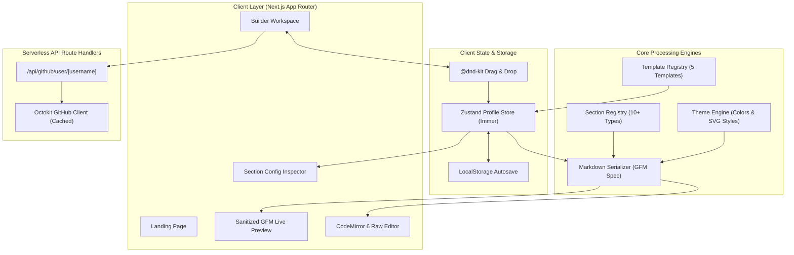

# ProfileForge — Master Implementation Plan & Technical Specification

> **Version**: 1.0.0  
> **Type**: Open-source Developer Tool / Web Application  
> **Output**: GitHub Profile README.md  
> **Core Stack**: Next.js 15, TypeScript, Tailwind CSS, shadcn/ui, Zustand, dnd-kit, CodeMirror 6, Octokit  

---

## 1. Project Vision & Core Principles

**ProfileForge** is an open-source visual GitHub Profile README builder designed to eliminate the manual toil of crafting high-impact developer profiles. Developers can import their real GitHub activity, pick from 5 professionally designed templates, visually reorder and configure sections via drag-and-drop, customize themes, and export 100% GitHub-compatible Markdown.

### Core Principles
- **Beautiful by Default**: Every template and component looks polished out of the box in both GitHub Dark and Light modes.
- **True GitHub Flavored Markdown (GFM)**: Emits clean, deterministic Markdown and supported HTML tags—never brittle browser UI markup.
- **Zero Mandatory Barrier to Entry**: Works immediately in the browser without sign-up, database requirements, or tracking.
- **Data-Driven & Portable**: Entire profile states are represented as versioned JSON configurations that can be imported, exported, and backed up.

---

## 2. System Architecture



---

## 3. Technology Stack

| Layer | Technology | Purpose |
|---|---|---|
| **Framework** | Next.js 15 (App Router) | Server-side rendering, API routes, optimized static builds |
| **Language** | TypeScript (Strict Mode) | Full compile-time type safety across data schemas and serializers |
| **Styling** | Tailwind CSS + CSS Variables | Utility-first styling with dark/light mode tokens |
| **Component Primitives** | Radix UI + Lucide React | Accessible UI components, tooltips, modals, icons |
| **State Management** | Zustand + Immer | Global reactive state for profile sections, theme, and history |
| **Drag & Drop** | `@dnd-kit/core` + `@dnd-kit/sortable` | Accessible, touch- & keyboard-friendly section reordering |
| **Forms & Validation** | React Hook Form + Zod | Schema-based validation for profile configs and inputs |
| **Markdown Processing** | `react-markdown`, `remark-gfm`, `rehype-sanitize` | Safe, real-time preview approximating GitHub's web view |
| **Raw Editor** | CodeMirror 6 (`@uiw/react-codemirror`) | Monospaced editor for direct Markdown inspection and copy |
| **GitHub Integration** | `@octokit/rest` | Fetching public profile data, star counts, top languages |
| **Packaging & Export** | `jszip`, `file-saver`, `canvas-confetti` | ZIP packaging, README.md downloads, JSON import/export |
| **Testing** | Vitest | Fast unit testing for Markdown serializers and schema migrations |

---

## 4. MVP Scope Matrix

### Must Have (MVP — Current Focus)
- [x] Next.js 15 + TypeScript + Tailwind CSS scaffolding.
- [ ] Responsive Visual Builder layout with collapsible panels and split preview.
- [ ] Drag-and-drop section manager using `@dnd-kit` (reorder, toggle visibility, duplicate, remove).
- [ ] Real GitHub profile import (via username) with cached server-side API.
- [ ] 5 initial templates:
  1. **Minimal**: Clean typographic layout, concise bio, subtle badges.
  2. **Professional**: Structured executive summary, tech stack grid, experience highlights.
  3. **Modern Developer**: High-impact banner, animated typing text, streak & trophy cards.
  4. **Terminal**: Monospaced hacker aesthetic (`$ whoami`, `$ cat skills.sh`).
  5. **Creative**: Dynamic SVG widgets, colorful badges, snake contribution preview.
- [ ] 10 core reusable profile sections:
  1. Profile Header (Avatar, Title, Subtitle, Banner, Typing text)
  2. About Me / Bio (Markdown bullet points, current focus)
  3. Social Links (Shields.io badge pills with icons and links)
  4. Tech Stack (Categorized skills: Frontend, Backend, Database, Cloud/DevOps)
  5. GitHub Stats Card (Total stars, commits, PRs, issues)
  6. Top Languages Card (Repository language distribution)
  7. GitHub Streak Card (Current streak, longest streak)
  8. Pinned / Featured Projects (Repository showcase cards)
  9. Current Status / Learning (What I'm currently building and exploring)
  10. Visitor Counter & Quote Widget (Dynamic SVG badges)
- [ ] 6 pre-built themes: GitHub Dark, GitHub Light, Dracula, Nord, Tokyo Night, Catppuccin.
- [ ] Clean GFM Serializer generating deterministic, properly escaped Markdown.
- [ ] Live preview with real-time sync and desktop/mobile viewport toggle.
- [ ] Export actions: One-click copy, download `README.md`, download ZIP bundle, export/import JSON config.
- [ ] LocalStorage persistence for autosave and crash recovery.
- [ ] Unit tests for serializers and Zod schemas.

### Post-MVP / Future Roadmap
- GitHub OAuth integration & 1-click direct publishing to `username/username` repository.
- PostgreSQL + Prisma cloud storage for cross-device synchronization.
- AI Bio Assistant for automated summaries and profile enhancements.
- Community template marketplace.

---

## 5. Core Data Model & Configuration Schema

All profiles adhere to a strict versioned JSON schema validated by Zod:

```typescript
export interface ProfileConfig {
  version: number; // e.g. 1
  templateId: string; // "minimal" | "professional" | "modern" | "terminal" | "creative"
  themeId: string; // "github-dark" | "dracula" | "nord" | etc.
  themeOverrides?: {
    primaryColor?: string;
    accentColor?: string;
    backgroundColor?: string;
  };
  sections: SectionItem[];
}

export interface SectionItem {
  id: string; // UUID or unique stable string (e.g. "sec_header_1")
  type: SectionType; // "header" | "about" | "socials" | "tech-stack" | "stats" | etc.
  enabled: boolean;
  title?: string;
  config: Record<string, any>; // Specific to section type
}
```

---

## 6. Detailed Implementation Roadmap

### Phase 1: Environment & Tooling Scaffolding (Current)
- [x] Initialize Next.js 15, TypeScript strict mode, and Tailwind CSS.
- [x] Configure paths (`@/*`), `vitest.config.ts`, `.gitignore`, and `.env.example`.
- [ ] Install production and dev dependencies.
- [ ] Verify test runner and basic compilation (`pnpm typecheck`, `pnpm test`).

### Phase 2: Design System & Common UI Components
- [ ] Implement design tokens in `src/styles/globals.css`.
- [ ] Create core UI primitives in `src/components/ui/` (`Button`, `Input`, `Dialog`, `Tabs`, `Card`, `Badge`, `Switch`, `Select`, `Tooltip`, `Sonner`).
- [ ] Build global navigation and header toolbar with export actions.

### Phase 3: Zod Schemas & State Management
- [ ] Define schemas in `src/schemas/profile.schema.ts` for each section type.
- [ ] Implement Zustand profile store in `src/stores/use-profile-store.ts` with:
  - Add, remove, duplicate, reorder, and update actions.
  - History tracking (undo / redo).
  - LocalStorage automatic sync.

### Phase 4: Markdown Serialization Engine
- [ ] Create `src/lib/markdown/serializer.ts` with dedicated modular serializers for each section:
  - `header.serializer.ts`
  - `about.serializer.ts`
  - `socials.serializer.ts`
  - `tech-stack.serializer.ts`
  - `stats.serializer.ts`
  - `projects.serializer.ts`
- [ ] Build SVG widget URL builder with theme query string injection.
- [ ] Add snapshot tests in `tests/unit/serializer.test.ts`.

### Phase 5: GitHub API Client & Data Import
- [ ] Implement API route `src/app/api/github/user/[username]/route.ts` using Octokit.
- [ ] Fetch user bio, avatar, location, company, blog, twitter, top starred repos, and primary languages.
- [ ] Implement in-memory / HTTP response caching to handle GitHub public rate limits gracefully.
- [ ] Create `GitHubImportModal` allowing 1-click profile pre-population.

### Phase 6: Visual Profile Builder & Drag-and-Drop
- [ ] Build split-panel builder workspace (`react-resizable-panels`).
- [ ] Implement `@dnd-kit` sortable list in `src/components/editor/sortable-section-list.tsx`.
- [ ] Create inspector forms for all 10 section types with live schema validation.
- [ ] Create template switcher and theme picker.

### Phase 7: Live Preview & CodeMirror Editor
- [ ] Implement GFM sanitized preview in `src/components/preview/markdown-preview.tsx`.
- [ ] Integrate CodeMirror 6 in `src/components/preview/raw-editor.tsx`.
- [ ] Add viewport toggle (Desktop / Mobile preview / Split view).

### Phase 8: Export Engine & Persistence
- [ ] Implement copy-to-clipboard with toast notification and confetti effect.
- [ ] Implement `README.md` and `profileforge-config.json` download.
- [ ] Implement ZIP bundle generation via `jszip`.
- [ ] Implement JSON file import to restore past configurations.

### Phase 9: Marketing Landing Page & Open Source Polish
- [ ] Create responsive landing page with Hero, Live Interactive Preview, Feature Grid, and Template Gallery.
- [ ] Add open-source files: `README.md`, `LICENSE`, `CONTRIBUTING.md`, `SECURITY.md`.
- [ ] Setup GitHub Actions CI workflow for linting, typechecking, and tests.

---

## 7. Quality Assurance & Verification

- **Unit Testing**: Vitest suite verifying serialization logic, edge-case escaping (pipes in tables, HTML injection, broken URLs).
- **GFM Compatibility Test**: Export test files from all 5 templates and verify rendering against GitHub's Markdown parser.
- **Responsive Layout Test**: Ensure drag-and-drop and inspector panels function smoothly on viewports from 375px to 1920px.

